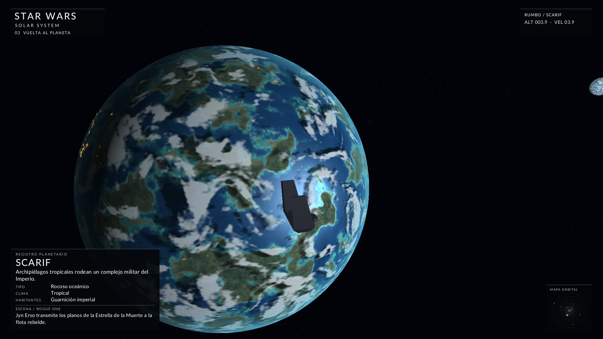

Universidad del Valle de Guatemala

Facultad de Ingeniería

Gráficas por Computadora

# Proyecto 3: Star Wars Solar System

Juan Francisco Orozco Mijangos (24647)

## Descripción del proyecto

Se realizó de forma individual un sistema solar de ficción inspirado en Star Wars. Se incorporaron Tatooine, Mustafar, Scarif, Naboo, Kashyyyk, Kamino, Bespin y Hoth, además de los dos soles Tatoo I y Tatoo II. Cada planeta tiene una órbita en el plano XZ, una rotación propia y una apariencia procedural. Se utilizó una escala comprimida para recorrer el sistema y observar las superficies en un mismo vuelo.

Se amplió el rasterizador en CPU del Laboratorio 6 para cargar la esfera y la nave modelada en Blender. Se aplicaron transformaciones de modelo y vista, proyección en perspectiva, recorte contra el plano cercano y una prueba de profundidad compartida entre todos los objetos. El color de cada fragmento se calcula mediante shaders propios. Se combinaron ruido, máscaras y funciones matemáticas para representar dunas, lava, bosques, hielo, arrecifes y atmósferas. El plasma, las nubes y otros patrones cambian con el tiempo. [Geometría](src/geometry.rs) · [Pipeline](src/pipeline.rs) · [Shaders](src/shaders.rs)

Se implementó vuelo libre en tres dimensiones, con aceleración, frenado y giro progresivos. El mouse orienta la nave y la cámara, mientras que el teclado permite desplazarse. La cámara conserva la nave cerca del centro, ligeramente debajo de la mira. Se añadió un modo local para rodear un planeta cercano y una detección de colisiones para impedir que la nave y la cámara atraviesen los cuerpos. El acercamiento y el alejamiento se realizan de forma continua. [Sistema y navegación](src/system.rs)

Para mantener el rendimiento, se generaron cuatro niveles de subdivisión de la esfera y se selecciona el nivel de detalle según su tamaño en pantalla. Los cuerpos fuera del campo de visión se descartan antes de procesar sus triángulos. La rasterización se distribuye entre varios hilos de CPU. Raylib se utiliza para abrir la ventana, leer las entradas y mostrar el framebuffer de 1600 × 900. Con `F3` se pueden consultar los contadores de triángulos y cuerpos descartados.

Se diseñó una interfaz con tipografía blanca, un mapa orbital pequeño y fichas que aparecen al apuntar a un planeta. Cada ficha incluye una descripción, sus habitantes, clima, tipo y una escena emblemática de una película. [Interfaz](src/hud.rs) · [Fichas planetarias](src/catalogue.rs)

## Video del recorrido

[](docs/recorrido.mp4)

[Ver o descargar el recorrido de 72 segundos a 1080p y 30 fps](docs/recorrido.mp4). Se grabó un vuelo que parte de una vista del sistema, se acerca a Scarif, completa una vuelta al planeta y se aleja hacia los dos soles. El recorrido se extendió para apreciar con más calma el acercamiento, la superficie y el entorno. El video y el modo `T` utilizan la misma trayectoria y el mismo rasterizador.

Se incorporaron los primeros 72 segundos de «Duel of the Fates», de John Williams, a partir del archivo proporcionado para el proyecto. Se ajustó el volumen y se aplicó una entrada y una salida suaves.

## Instalación y ejecución

Se requiere Rust estable con Cargo, CMake y Clang. En macOS, Clang forma parte de las herramientas de línea de comandos de Xcode, que se instalan con `xcode-select --install`. CMake se puede instalar con `brew install cmake` si se dispone de Homebrew.

Para compilar y ejecutar, se abre Terminal en la raíz del repositorio, donde se encuentra `Cargo.toml`, y se utilizan los siguientes comandos.

```sh
cargo build --release --locked
cargo run --release --locked
```

Se recomienda el perfil `release` para el vuelo. La compilación y las pruebas se verificaron en macOS con Apple Silicon.

### Controles

| Entrada | Vuelo libre | Vuelo local |
| --- | --- | --- |
| `W` / `S` | Avanzar / retroceder | Acercarse / alejarse del planeta |
| `A` / `D` | Desplazarse a la izquierda / derecha | Rodear el planeta en ambos sentidos |
| `Q` / `E` | Subir / bajar | Subir / bajar respecto al planeta |
| `1`–`8` | Seleccionar Tatooine, Mustafar, Scarif, Naboo, Kashyyyk, Kamino, Bespin u Hoth | Seleccionar el destino para volver al vuelo libre |
| Mantener `F` | Orientar la nave hacia el destino | Orientar la nave hacia el planeta local |
| Mover el mouse | Girar e inclinar la nave y la cámara. La mira activa la ficha del planeta observado. | Igual |
| `M` / `C` | Soltar o capturar el cursor / recentrar la cámara | Igual |
| Mayús | Activar el impulso mientras se acelera | Conservar la velocidad local |
| Espacio | Frenar | Frenar respecto al planeta |
| `L` | Activar el modo local a menos de 12 unidades de la superficie | Volver al vuelo libre |
| `O` / `H` | Mostrar u ocultar las trazas orbitales / la ayuda | Igual |
| `F3` | Mostrar u ocultar los contadores de diagnóstico | Igual |
| `T` / `R` / Esc | Iniciar o interrumpir el recorrido / reiniciar / salir | Igual |

Para llegar a Scarif, se selecciona el destino con `3` y se mantienen `F` y `W` durante el acercamiento. Cuando `ALT` baja de 12, se suelta el acelerador y se pulsa `L`. Con `A` o `D` se rodea el planeta, con `W` se reduce la distancia y con `S` se aumenta. Mantener `F` permite conservar el planeta frente a la mira durante la vuelta. La nave se detiene al alcanzar el límite de seguridad.

### Pruebas

```sh
cargo test --release --locked
```

Se verifican las órbitas, el vuelo local, las colisiones y la orientación del modelo importado. También se comprueba que el mouse cambie el rumbo con la nave encuadrada, que el desplazamiento lateral conserve la orientación y que un planeta oculto por una estrella no active su ficha.

## Recursos

- La nave se modeló en Blender para esta entrega individual. [Original de Blender](assets/nave_kylo2.blend) · [Modelo OBJ](assets/nave_kylo2.obj)
- Se reutilizó la esfera proporcionada en clase y se adaptaron los materiales procedurales del Laboratorio 6. Se utilizó Codex como apoyo para implementar el rasterizador, la navegación, los shaders y las pruebas.
- La tipografía Lato Medium se distribuye con su licencia SIL Open Font License. [Licencia](assets/fonts/OFL-Lato.txt)
- Se consultó jsOrrery como referencia para la presentación del plano orbital y la selección de un cuerpo. [jsOrrery](https://mgvez.github.io/jsorrery/)
- Referencias de los planetas para las fichas. [Tatooine](https://www.starwars.com/databank/tatooine) · [Mustafar](https://www.starwars.com/databank/mustafar) · [Scarif](https://www.starwars.com/databank/scarif) · [Naboo](https://www.starwars.com/databank/naboo) · [Kashyyyk](https://www.starwars.com/databank/kashyyyk) · [Kamino](https://www.starwars.com/databank/kamino) · [Bespin](https://www.starwars.com/databank/bespin) · [Hoth](https://www.starwars.com/databank/hoth)
- Referencias de escenas y del modelo. [Puesta de los dos soles](https://www.starwars.com/news/star-wars-50-filming-begins) · [Misión de Rogue One](https://www.starwars.com/databank/k-2so-kay-tuesso) · [Duelo en Naboo](https://www.starwars.com/video/reactor-core-duel) · [Historia de El Imperio contraataca](https://www.starwars.com/star-wars-episode-5-the-empire-strikes-back-story-gallery) · [Nave de Kylo Ren](https://www.starwars.com/databank/kylo-rens-command-shuttle)
